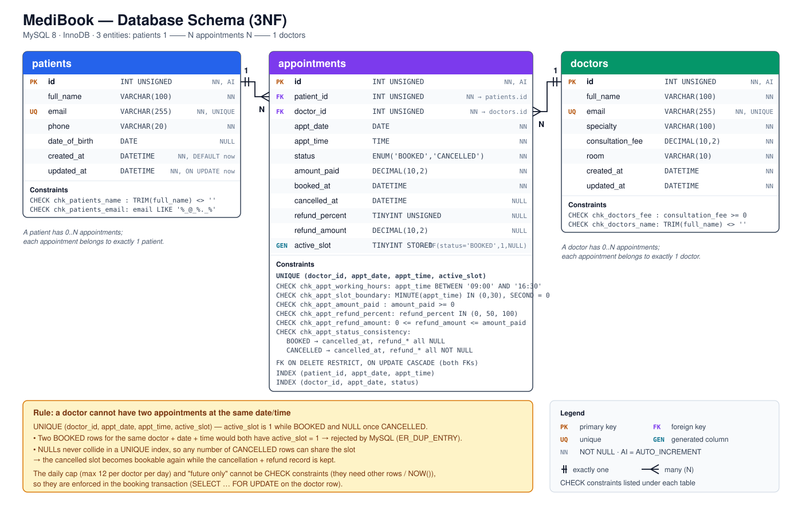

# MediBook — Clinic Appointment Booking API

Backend for a community clinic: patients book 30-minute slots with doctors (09:00–17:00, max 12 per doctor per day), cancel with a notice-based refund, join a waitlist when a slot is full, and staff get statistics and reports.

**Stack:** Node.js · Express · MySQL 8 (`mysql2`, parameterized queries only, no ORM) · Redis (`ioredis`) · Jest

## Demo video

▶️ [Watch the walkthrough on Google Drive](https://drive.google.com/drive/folders/1tUnmhtX1Sg4upuLPTe5QN7ieYInxbSTO?usp=drive_link)

---

## Contents

1. [Setup](#1-setup)
2. [Project structure](#2-project-structure)
3. [Database design (Part A/B)](#3-database-design-part-ab)
4. [API reference (Part C)](#4-api-reference-part-c)
5. [Business rules — design justifications (Part C)](#5-business-rules--design-justifications-part-c)
6. [Audit log with `fs` (Part D)](#6-audit-log-with-fs-part-d)
7. [Queues & Redis — waitlist and notifications (Part E)](#7-queues--redis--waitlist-and-notifications-part-e)
8. [Unit tests (Part F)](#8-unit-tests-part-f)
9. [Course feedback page — i18n (Part G)](#9-course-feedback-page--i18n-part-g)

---

## 1. Setup

### Prerequisites

- Node.js 18+ (developed on Node 22)
- MySQL **8.0.16 or newer** (CHECK constraints are enforced from 8.0.16)
- Redis 6.2+ (the worker uses `BLMOVE`)

### Option A — MySQL and Redis with Docker (easiest)

```bash
cp .env.example .env          # Windows PowerShell: Copy-Item .env.example .env
# set DB_PASSWORD in .env (docker-compose uses it as the MySQL root password)
docker compose up -d          # runs database/schema.sql then database/seed.sql on first start
```

### Option B — your own MySQL and Redis

```bash
cp .env.example .env          # then fill in DB_HOST, DB_USER, DB_PASSWORD, REDIS_URL
mysql -u root -p < database/schema.sql
mysql -u root -p < database/seed.sql
```

`schema.sql` creates the `medibook` database and drops/recreates the three tables, so it can be re-run to reset everything. Seed dates are relative to `CURDATE()` so the demo data is always "upcoming".

### Run

```bash
npm install
npm start            # API on http://localhost:3000
npm run worker       # in a second terminal: the background worker (waitlist + notifications)
npm test             # unit tests — no MySQL or Redis needed
```

`GET /health` reports whether MySQL and Redis are reachable.

### Environment variables (`.env.example`)

| Variable | Default | Purpose |
|---|---|---|
| `PORT` | `3000` | HTTP port |
| `DB_HOST` / `DB_PORT` / `DB_USER` / `DB_PASSWORD` / `DB_NAME` | `127.0.0.1` / `3306` / `root` / – / `medibook` | MySQL connection |
| `REDIS_URL` | `redis://127.0.0.1:6379` | Redis connection |
| `AUDIT_LOG_PATH` | `logs/audit.log` | JSON-lines audit log |
| `WAITLIST_SWEEP_MS` | `60000` | How often the worker re-checks waitlists for free slots |

`.env` is git-ignored; no secrets are committed.

---

## 2. Project structure

```
├── database/
│   ├── schema.sql            DDL: database, 3 tables, PK/FK/UNIQUE/CHECK constraints
│   └── seed.sql              sample data (5 patients, 4 doctors, 17 appointments)
├── locales/                  en.json, fr.json  (feedback page strings)
├── schema-diagram.svg        database schema diagram
├── src/
│   ├── app.js                Express app: middleware, routes, error handling
│   ├── server.js             starts the HTTP server            (npm start)
│   ├── worker.js             background worker process          (npm run worker)
│   ├── config/               env, MySQL pool + transaction helper, Redis client
│   ├── models/               ALL SQL lives here (parameterized with ?)
│   ├── controllers/          request validation + business logic, call models/services
│   ├── routes/               URL + HTTP method → controller
│   ├── services/             booking/cancel workflow, waitlist, Redis queues, audit logger
│   ├── middleware/           async wrapper, 404 + central error handler
│   ├── utils/                pure functions: refund calculator, slot validation, validators, i18n
│   └── views/                HTML for the feedback page
└── tests/                    Jest unit tests
```

**Layering rule:** routes → controllers → services → models. Only `src/models/` contains SQL. The `services/` layer exists because the booking/cancellation rules are needed by *two* callers (the HTTP controller and the worker), so they live in one place instead of being duplicated.

---

## 3. Database design (Part A/B)



### Normalization of the original spreadsheet

| Step | Problem in the spreadsheet | Fix |
|---|---|---|
| **1NF** | Already atomic, but `appt_datetime` mixes two facts we query separately | Split into `appt_date DATE` + `appt_time TIME` (lets the DB check working hours / slot boundaries and count per day) |
| **2NF** | (n/a with a single-column key `appt_ref`) | — |
| **3NF** | `patient_email`, `patient_phone` depend on the patient, not on the appointment (`appt_ref → patient_name → email`). `specialty`, `consultation_fee`, `room` depend on the doctor (`appt_ref → doctor_name → fee`). Ama Mensah's details are repeated; changing Dr. Boateng's room means editing many rows (update anomaly) | Move them to `patients` and `doctors`; `appointments` keeps only foreign keys |

**Kept on `appointments` on purpose:** `amount_paid`. It is *not* derived from `doctors.consultation_fee` — the spreadsheet shows AP-002 paid 120.00 against a 150.00 fee, and a fee can change later without rewriting payment history. It is a fact about the transaction, so it belongs to the transaction.

**Refund history with only 3 tables:** a cancellation is stored on the appointment row itself (`status`, `cancelled_at`, `refund_percent`, `refund_amount`). Cancelled rows are never deleted.

### Relationships

- `patients 1 ── N appointments` (`appointments.patient_id → patients.id`)
- `doctors 1 ── N appointments` (`appointments.doctor_id → doctors.id`)
- Patients and doctors are many-to-many *through* appointments.
- FKs are `ON DELETE RESTRICT` — a patient/doctor with appointment history cannot be deleted (would destroy payment/refund records). The API returns `409 HAS_APPOINTMENTS` instead of letting the DB error surface.

### "A doctor cannot have two appointments at the same date/time"

```sql
active_slot TINYINT AS (IF(status = 'BOOKED', 1, NULL)) STORED,
CONSTRAINT uq_doctor_active_slot UNIQUE (doctor_id, appt_date, appt_time, active_slot)
```

A plain `UNIQUE (doctor_id, appt_date, appt_time)` would make a cancelled slot un-bookable forever (the cancelled row would still occupy it). With the generated column, booked rows have `active_slot = 1` so two of them collide, while cancelled rows have `NULL`, and NULLs never collide in a MySQL unique index. Result: **at most one booked appointment per doctor slot, enforced by the database**, and cancelled rows are kept.

Other constraints (all on the diagram): working hours `CHECK (appt_time BETWEEN '09:00:00' AND '16:30:00')`, slot boundary `CHECK (MINUTE(appt_time) IN (0,30) AND SECOND(appt_time) = 0)`, non-negative money, refund ≤ amount paid, refund percent ∈ {0, 50, 100}, and a status-consistency CHECK (a BOOKED row has no cancellation data; a CANCELLED row must have all of it). Rules that need other rows or the current time (12-per-day cap, "future only") cannot be CHECK constraints in MySQL, so they are enforced in the booking transaction.

### Seed data

5 patients, 4 doctors (**Dr. Ofori has no appointments**), 17 appointments including: Dr. Boateng with **11 of 12 slots** booked on one day (a busy day, one slot from the cap) plus a cancelled slot with a 100% refund; a past appointment; a 50% refund cancellation; the AP-002-style discounted payment (120.00).

---

## 4. API reference (Part C)

All JSON responses are `{ "data": … }` on success and `{ "error": { "code", "message", "details?" } }` on failure.

### Patients

| Method | Path | Description | Success |
|---|---|---|---|
| GET | `/api/patients` | List patients | 200 |
| GET | `/api/patients/:id` | One patient | 200 / 404 |
| POST | `/api/patients` | Create `{ full_name, email, phone, date_of_birth? }` | 201 + `Location` |
| PUT | `/api/patients/:id` | Replace (all required fields) | 200 |
| PATCH | `/api/patients/:id` | Partial update | 200 |
| DELETE | `/api/patients/:id` | Delete (only if no appointment history) | 204 / 409 |
| GET | `/api/patients/:id/appointments` | The patient's appointments | 200 |

### Doctors

| Method | Path | Description | Success |
|---|---|---|---|
| GET | `/api/doctors[?specialty=]` | List doctors | 200 |
| GET | `/api/doctors/:id` | One doctor | 200 / 404 |
| POST | `/api/doctors` | Create `{ full_name, email, specialty, consultation_fee, room }` | 201 |
| PUT / PATCH | `/api/doctors/:id` | Replace / partial update | 200 |
| DELETE | `/api/doctors/:id` | Delete (only if no appointment history) | 204 / 409 |
| GET | `/api/doctors/:id/stats` | **Doctor statistics** (Part C.4) | 200 |
| GET | `/api/doctors/:id/availability?date=` | Booked and free slots for a day | 200 |
| GET | `/api/doctors/:id/waitlist?date=` | Waitlist for a doctor-day | 200 |
| POST | `/api/doctors/:id/waitlist` | Join waitlist `{ patient_id, date, preferred_time? }` | 201 / 409 |
| DELETE | `/api/doctors/:id/waitlist/:patientId?date=` | Leave waitlist | 204 |

### Appointments

| Method | Path | Description | Success |
|---|---|---|---|
| POST | `/api/appointments` | **Book** `{ patient_id, doctor_id, date: "YYYY-MM-DD", time: "HH:MM", join_waitlist?: bool }` | 201 (booked) / 202 (waitlisted) |
| GET | `/api/appointments[?doctor_id=&patient_id=&date=&status=]` | List with filters | 200 |
| GET | `/api/appointments/:id` | One appointment | 200 / 404 |
| DELETE | `/api/appointments/:id` | **Cancel** — response includes the refund | 200 |

### Reports and admin

| Method | Path | Description |
|---|---|---|
| GET | `/api/reports/doctors` | Every doctor's appointments and revenue, including doctors with none (Part C.5) |
| GET | `/api/reports/busy-days[?from=&to=]` | Every (doctor, date) above 80% of the daily cap (Part C.6) |
| GET | `/api/waitlist/failed` | Waitlist entries that could not be promoted (dead-letter list) |
| GET | `/health` | MySQL + Redis status |
| GET | `/feedback[?lang=fr]` | Course feedback page (Part G) |

### Status codes

| Code | When |
|---|---|
| 200 / 201 / 204 | OK / created (with `Location` header) / deleted |
| 202 | Slot unavailable and the patient was put on the waitlist (`join_waitlist: true`) |
| 400 | Malformed input: missing/unknown fields, wrong types, invalid JSON, `2026-02-30`, `25:00` |
| 404 | Patient / doctor / appointment / route not found |
| 409 | Conflict with current state: slot taken, doctor's day full, patient already booked at that time, already cancelled, duplicate email, delete with history, already on waitlist |
| 422 | Well-formed but breaks a business rule: in the past, outside 09:00–17:00, not on a :00/:30 boundary, cancelling an appointment that already started |
| 503 | Redis unavailable for a waitlist operation |
| 500 | Unexpected error (logged; generic message to the client) |

All errors go through one central middleware (`src/middleware/errorHandler.js`), which also maps raw MySQL errors (`ER_DUP_ENTRY`, `ER_ROW_IS_REFERENCED_2`, `ER_CHECK_CONSTRAINT_VIOLATED`) as a safety net.

### Example

```bash
curl -X POST http://localhost:3000/api/appointments -H "Content-Type: application/json" \
  -d '{"patient_id":1,"doctor_id":2,"date":"2026-12-01","time":"10:30"}'

curl -X DELETE http://localhost:3000/api/appointments/18
# → { "data": {..."status":"CANCELLED"...}, "refund": { "hours_notice": 52.4, "percent": 100, "amount": 100 }, ... }
```

---

## 5. Business rules — design justifications (Part C)

### Booking (`src/services/bookingService.js`)

1. **Slot validation** (pure function `validateSlot`, unit-tested): date/time must parse (`400`), be on a :00/:30 boundary, start between 09:00 and 16:30 — **16:30 is the last slot because a 30-minute appointment starting at 17:00 would end after closing** — and be strictly in the future (`422`).
2. **Transaction** (`withTransaction` in `src/config/db.js`):
   - `SELECT … FROM doctors WHERE id = ? FOR UPDATE` — locks the doctor row. Every booking for that doctor queues behind this lock, so the next two checks cannot be raced.
   - `SELECT … FROM patients WHERE id = ? FOR UPDATE` — same for the patient (lock order is always doctor → patient, so no deadlocks).
   - Count booked appointments for that doctor-day; `≥ 12` → `409 DOCTOR_DAY_FULL`.
   - Slot already booked → `409 SLOT_TAKEN`. Patient already booked at that time with another doctor → `409 PATIENT_DOUBLE_BOOKED`.
   - `INSERT`, with `amount_paid` = the doctor's current fee.
3. **Two patients, same slot, same instant:** the doctor-row lock serialises them, so the second sees the first's row and gets `409`. Even if the application check were bypassed, the `uq_doctor_active_slot` unique index makes MySQL reject the second insert (`ER_DUP_ENTRY` → `409 SLOT_TAKEN`). Defence in depth: app lock for the daily cap (which no index can express), DB constraint for the slot.
4. **After commit only:** audit-log line and confirmation job. Neither can fail the booking.
5. **Waitlist offer:** a `409 SLOT_TAKEN` / `DOCTOR_DAY_FULL` response contains `details.waitlist` describing how to join. Sending `"join_waitlist": true` in the booking request accepts the offer up front and returns `202`.

### Cancellation and refund (`cancelAppointment`)

- **Policy** (`src/utils/refund.js`): notice = appointment start − cancellation time.
  - `> 48 h` → **100%**
  - `24 h ≤ notice ≤ 48 h` → **50%**
  - `< 24 h` → **0%**
  - **Boundaries:** exactly 48 h is not "more than 48 hours", so 50%. Exactly 24 h is inside "24–48 hours", so 50%. Both are covered by tests.
  - Amounts are computed in integer cents to avoid floating-point errors, and are based on `amount_paid` (not the current fee).
- **Atomicity:** inside one transaction the appointment row is locked (`FOR UPDATE`), the refund is computed, and a *single* `UPDATE` sets `status`, `cancelled_at`, `refund_percent` and `refund_amount` together. The cancellation and its refund record cannot be half-written, and the status-consistency CHECK constraint also guarantees it at the DB level.
- **Already cancelled** → `409`; **already started/past** → `422`. `WHERE status = 'BOOKED'` in the UPDATE makes a double-cancel race harmless.
- **Slot freed, history kept:** the row stays as `CANCELLED` (soft delete), so `active_slot` becomes `NULL` and the slot is bookable again.
- **Why `DELETE /api/appointments/:id`:** from the client's point of view the booking is removed and the slot released. The server keeps the row as financial history, which is a standard soft delete. It returns `200` with a body (not `204`) because the client needs the refund amount.
- After commit: audit-log line plus a `SLOT_FREED` job for the waitlist worker.

### Doctor statistics (`GET /api/doctors/:id/stats`)

All computed in SQL (`doctorModel.getSummaryStats`, `getNext7Days`):
- `revenue_collected` = Σ(`amount_paid` − refunds). Money paid at booking and not refunded.
- `upcoming_appointments` = booked and starting after now.
- `next_7_days`: today + 6 days, generated by a **recursive CTE** and `LEFT JOIN`ed so days with 0 bookings still appear, each with count, remaining slots and utilization %.
- `utilization_next_7_days_percent` = booked in those 7 days ÷ (12 × 7).
- "Now" and "today" are passed from Node as parameters so SQL and JavaScript always agree on the clinic's local time (even if the MySQL server runs in UTC).

### Reports (advanced SQL)

- **Doctors report:** `doctors LEFT JOIN appointments … GROUP BY doctor`, with conditional aggregates `SUM(a.status = 'BOOKED')` and `COALESCE(…, 0)`, so doctors with zero appointments are listed with zeros. `total_appointments` counts active (non-cancelled) bookings. Cancelled count, gross paid, refunded and net revenue are separate columns.
- **Busy days:** `GROUP BY doctor, date HAVING COUNT(*) > 12 × 0.8` (i.e. 10+ booked), with utilization %. Optional `from`/`to` filters.

---

## 6. Audit log with `fs` (Part D)

`src/services/auditLogger.js`:
- Appends one JSON object per line to `logs/audit.log` with `fs/promises.appendFile`. It's asynchronous and non-blocking, with no `*Sync` calls.
- Creates `logs/` on first use with `fs.mkdir(dir, { recursive: true })` (memoised, retried if it failed).
- **Never throws:** errors are caught and printed to stderr. Controllers call `audit(...)` without `await`, so a slow or broken disk can neither fail nor delay the user's request.
- Events: `APPOINTMENT_BOOKED`, `APPOINTMENT_CANCELLED` (with refund), `WAITLIST_JOINED/PROMOTED/SKIPPED/EXPIRED/PROMOTION_FAILED`, `NOTIFICATION_SENT` (from the worker).
- The API and the worker both append to the same file. Each line is a single `appendFile` call (`O_APPEND`), so lines from the two processes don't interleave.

```json
{"timestamp":"2026-11-22T13:05:01.123Z","event":"APPOINTMENT_CANCELLED","appointmentId":18,"reference":"AP-018","hoursNotice":52.4,"refundPercent":100,"refundAmount":100}
```

---

## 7. Queues & Redis — waitlist and notifications (Part E)

The worker (`src/worker.js`, `npm run worker`) is a **separate process** from the web server.

### Redis keys

| Key | Type | Purpose |
|---|---|---|
| `medibook:jobs` | List | Job queue (`SEND_CONFIRMATION`, `SLOT_FREED`) |
| `medibook:jobs:processing` | List | Jobs taken by the worker but not finished |
| `medibook:jobs:failed` | List | Jobs that failed 5 times (dead letter) |
| `medibook:waitlist:{doctorId}:{date}` | List | FIFO waitlist for one doctor-day |
| `medibook:waitlist:members:{doctorId}:{date}` | Set | Prevents the same patient joining twice |
| `medibook:waitlist:index` | Set | Which doctor-days have a waitlist (for the sweep) |
| `medibook:waitlist:inflight` | List | Entry currently being promoted (crash marker) |
| `medibook:waitlist:failed` | List | Entries that could not be promoted, with the reason |

### Waitlist flow

1. Booking fails with `SLOT_TAKEN` or `DOCTOR_DAY_FULL` → the 409 response offers the waitlist. The patient either calls `POST /api/doctors/:id/waitlist` or re-sends the booking with `join_waitlist: true`. A `preferred_time` means "only this slot"; without it, any slot that day. Joining is refused (`409 SLOT_AVAILABLE`) if what they want is actually free, since they should just book it.
2. Cancellation → `SLOT_FREED { doctorId, date, time }` job.
3. Worker takes the job and walks the waitlist **oldest first**, picking the first entry whose preferred time matches (or has none), and books it through **the same `bookAppointment` function as the API**. Same rules, same locks, same confirmation job.

### What if the promoted booking fails? ("book first, then dequeue")

The waitlist entry is **only removed from Redis after the MySQL booking has committed**. It is never popped first, so there is no moment when the patient exists in neither place.

| Failure | Handling |
|---|---|
| Slot grabbed by someone else first (`SLOT_TAKEN`/`DOCTOR_DAY_FULL`) | Entry stays on the waitlist **in the same position**; promotion for this slot stops |
| Patient already has another appointment at that time | Entry stays; the slot is offered to the next patient |
| Permanent error (patient/doctor deleted, etc.) | Entry is moved to `medibook:waitlist:failed` **with the reason** and audit-logged, so staff can contact the patient (`GET /api/waitlist/failed`). It is never silently dropped |
| Transient error (MySQL/Redis down) | Entry untouched; the job is retried (up to 5 times with back-off, then the job goes to `jobs:failed`) |
| Worker crashes mid-promotion | On restart, `inflight` entries are reconciled: if the booking committed, the entry is removed; otherwise it is still on the waitlist and will be retried. Unfinished jobs in `jobs:processing` are moved back to `jobs` |
| `SLOT_FREED` job lost (Redis down at cancel time) | A periodic **sweep** (every 60 s) checks every waitlisted doctor-day for free slots and promotes. It also expires entries whose date has passed (to the failed list) |

Jobs use the **reliable-queue pattern**: `BLMOVE jobs → jobs:processing` atomically, then `LREM` on success, so a job is always in exactly one Redis list, even if the worker dies. A `SET NX PX` lock per doctor-day means several workers can run without promoting the same slot twice.

### Notification jobs

Every confirmed appointment, from the API or from a waitlist promotion, enqueues `SEND_CONFIRMATION`. The worker "sends" it by writing an SMS and an email `NOTIFICATION_SENT` line to the audit log. If Redis is down when enqueuing, the booking still succeeds and a `NOTIFICATION_ENQUEUE_FAILED` audit line is written.

---

## 8. Unit tests (Part F)

`npm test` runs Jest. Tests use only pure functions, with **no MySQL or Redis**, and a fixed "now" so they don't depend on the clock.

- `tests/refund.test.js`: the three tiers, **exactly 48 h → 50%**, 48 h + 1 s → 100%, **exactly 24 h → 50%**, 24 h − 1 s → 0%, cent rounding, invalid input.
- `tests/slot.test.js`: 09:00 and 16:30 accepted; **17:00 exactly rejected**; **09:15 rejected**; 08:30 rejected; past / exactly-now / later-today; **malformed dates** (`2026-02-30`, `2026-13-01`, `10/08/2026`) and times (`25:00`, `9:00`, `noon`); leap years.
- `tests/validators.test.js`: patient/doctor body validation, id parsing (including `"1 OR 1=1"`), language fallback.

---

## 9. Course feedback page — i18n (Part G)

- `GET /feedback` serves an HTML form with the 5 essay questions, each in a `<textarea>`. `POST /feedback` validates that all 5 are answered and shows a localized thank-you page.
- Title, instructions, the 5 questions and every label are loaded from `locales/en.json` / `locales/fr.json` (read with `fs/promises`, cached).
- `/feedback?lang=fr` shows French. The default is English, and any unsupported value (`?lang=de`, `?lang=`, `?lang=fr&lang=en`, `?lang=../../x`) falls back to English. Only whitelisted language codes are ever turned into a file path.
- Today's date is formatted with `Intl.DateTimeFormat(locale, { dateStyle: 'full' })`, e.g. "Sunday 22 November 2026" vs "dimanche 22 novembre 2026". `<html lang>` is set to match.
